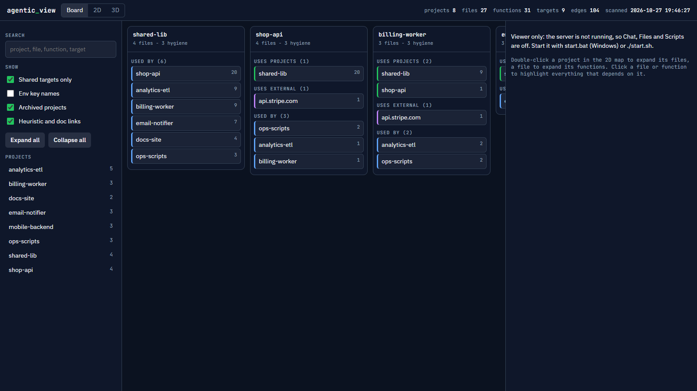
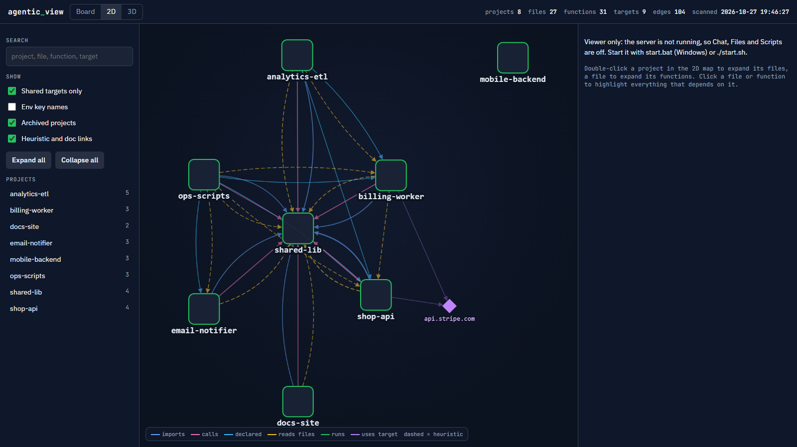
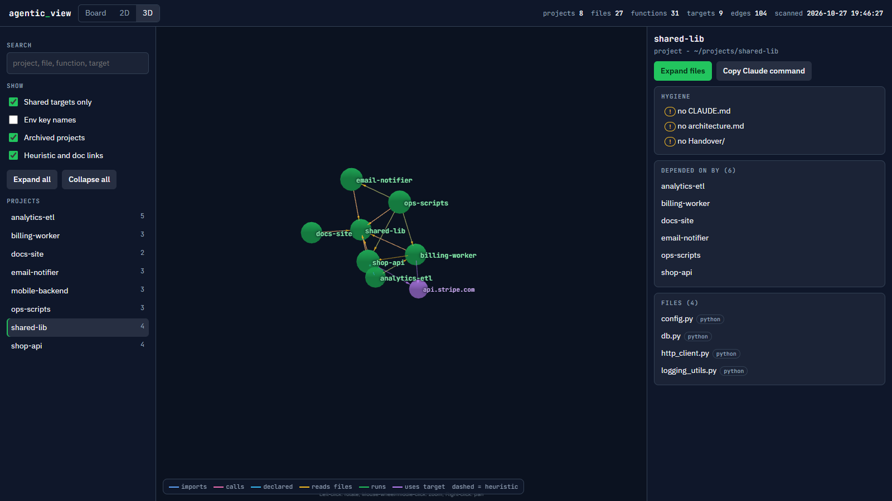

# Agentic View

Scan a folder of projects and see how they connect. Agentic View builds a dependency map (imports, function calls, scripts that run other scripts, projects that read each other's files, shared external systems) and lets you manage those projects from one page.



| 2D map | 3D map |
|---|---|
|  |  |

Screenshots use a made-up set of eight demo projects.

**Install:** see [INSTALL.md](INSTALL.md) for step-by-step instructions. Using an AI assistant? Tell it: "Install Agentic View from https://github.com/dnizdz/Agentic_View following INSTALL.md".

## Why
Each project has its own focus and its own tasks, so an agent working on one should not load the others. Agentic View keeps agents small to cut token usage:

- The map shows which projects, files and functions are related, so an agent reads only what the task touches instead of the whole folder.
- `impact.py` and `out/INDEX.md` answer "what depends on this?" without opening code.
- Chat runs one live session per project, scoped to that project's folder and `CLAUDE.md`, with a lean context option that skips global settings and memory.

## What it does
- **Board:** a kanban-style view, one column per project, with cards for the projects and external systems it uses and the projects that use it.
- **Map:** interactive 2D graph (project, then file, then function) and a 3D view, with impact highlighting.
- **For agents:** `impact.py` answers "what depends on this file?", plus `out/graph.json`, `out/impact.json` and `out/INDEX.md`.
- **Manage (optional local server):** a live Claude session per project, create new projects (goal, tasks, related projects), run and stop scanned scripts, view and edit project files, rescan, and set up Claude (install and sign in) from the page.

The scanner is read-only and never opens `.env` files (env key names found in code are recorded, values are not).

## Requirements
- **Python 3.9+** (standard library only). Windows: install from python.org and tick "Add python.exe to PATH", or run `winget install Python.Python.3`. Developed and tested on Python 3.13.
- **A modern browser.** The page loads Cytoscape.js, 3d-force-graph and fonts from public CDNs.
- **Claude Code** (only for chat). The map, board and scripts work without it. Install and sign in from the Setup screen in the page, or install it yourself first.

## Quick start
```
python scanner/scan.py --root /path/to/folder/of/projects
python scanner/impact.py path/of/some_file.py
```
Open `viewer/index.html` for the map only, or start the server for everything:
```
python server/server.py --open
```
One-step launcher (rescans, starts the server, opens the browser), one per OS:

| OS | Launcher | How |
|---|---|---|
| Windows | `start_windows.bat` | double-click |
| macOS | `start_mac.command` | double-click in Finder (first time: right-click, Open) |
| Ubuntu / Linux | `start_ubuntu.sh` | `./start_ubuntu.sh` (first time: `chmod +x start_ubuntu.sh`) |

For a Desktop icon, run `python create_shortcut.py` once (Windows `.lnk`, macOS `.command`, Linux `.desktop`). `--remove` deletes it.

All three need Python 3.9+. Every launch asks how much the app may do (press Enter for the default):

| Pick | Mode | What it allows |
|---|---|---|
| 1 | Read only | View the map, board and files. No edits, no scripts, chat is plan-only (`--read-only`). |
| 2 | Allow edit (default) | Edit files, run scripts, chat may edit and run python without asking (`--allow-edit`). |
| 3 | Allow bypass | Everything in 2, plus a chat switch that lets Claude run any command and edit any file without asking. You must type `YES` to confirm (`--allow-bypass`). |

The choice lasts until you stop the app and is kept across an in-app update restart. To skip the question (shortcuts, scripts), pass a flag: `start_windows.bat --read-only`, `./start_ubuntu.sh --allow-edit`, or `--allow-edit --allow-bypass`. Other flags such as `--port 9000` still show the question. Without a keyboard (no terminal) it starts in Allow edit. On Linux the "Open" buttons and the browser launch need `xdg-utils` (`sudo apt install xdg-utils`). Scheduler jobs read Windows Task Scheduler, so that tab is empty on macOS and Linux.

The current version is in `VERSION` (shown in the page header). See `CHANGELOG.md`.

**Updating without git:** click **Update** in the page header. It checks GitHub for the newest version tag, and on your confirmation downloads that release as a zip, replaces the app files (`scanner/`, `server/`, `viewer/`, launcher, docs), restarts the server and reloads the page, all by itself. Your `scanner/config.local.json`, `out/`, projects, `CLAUDE.md` and handover notes are not touched, and the old files are saved under `out/backups/update-*`. Live chat sessions end at the restart and resume on your next message. The restart is automatic when you started the app with a launcher (`start_windows.bat`, `start_mac.command`, `start_ubuntu.sh`); if you started `server/server.py` by hand, it starts a fresh copy itself (on Windows in a new console window). If you installed with `git clone`, use `git pull` instead (the button says so). To install the first time without git, use GitHub's green **Code** button, then **Download ZIP**, unzip, and run your launcher. The update needs internet access to github.com and, on macOS, the Python certificates installed (run `Install Certificates.command` from the Python folder in Applications if it reports a certificate error).

On the first run in a terminal, the scanner asks which folder holds your projects (Enter accepts the parent of this folder) and saves `scanner/config.local.json` (gitignored). To set it by hand, copy `scanner/config.example.json`.

**Scan root rule:** `root` is a folder whose subfolders are the projects. Agentic View skips its own folder automatically, so it can sit inside the scanned folder or elsewhere. In JSON, write Windows paths with forward slashes (`"C:/Users/you/Projects"`) or doubled backslashes. If the root has no project subfolders, the scan stops with "No projects found in <path>".

Scanner options: `--archive` includes `Archive/` folders, `--no-schedule` skips Windows Task Scheduler (read on Windows by default, read-only), `--no-cache` forces a full rescan.

## The local server
`server/server.py` is a browser-to-shell bridge, so it is strict:

- Binds `127.0.0.1` only. Host and Origin headers are checked. A random token is required on every API call.
- The page sends project and file ids. The server maps them to folders from your scan. No raw paths, commands or arguments come from the page.
- File edits stay inside the project folder, refuse secret files (`.env`, keys, tokens), and keep the previous version under `out/backups/`.
- Scripts run only if they appear in the scan, with no arguments, after a confirm dialog.
- Chat is a **live session**: one `claude` process per project stays open between messages (stream-json in and out), keeps its context like a terminal, survives page reloads (the transcript replays when you come back), and ends only when you press End session or stop the server. A mode or context change restarts it and resumes the same conversation. Up to 6 sessions at once.
- **`--allow-edit`** (the default pick in the launchers, ignored with `--read-only`): on top of Accept edits, chat may run `python ...` without asking. Anything else that needs approval (other commands) is still denied and listed. Note that `python *` can run any Python code, so use it only on projects you trust. If you run `python server/server.py` yourself, add the flag to get the same behaviour.
- New chats start in **Accept edits** (Claude edits files in the project without asking; on a `--read-only` server they start in plan-only). You can switch to follow-project-settings or plan-only. Tools that need approval are denied and listed in the chat (the CLI cannot ask the page). "Bypass ALL permissions" (`--dangerously-skip-permissions`) only works if you start the server with `--allow-bypass`, and asks for confirmation.
- **Context: full or lean.** Full loads your global Claude settings, memory and hooks on every cold start (about 45k tokens). Lean (`--setting-sources project,local`) loads only the project's settings and costs roughly half on a cold message. A warm live session is much cheaper per turn than a fresh call.
- **New project** (header button): creates `Brief/`, `Deliverables/`, `Handover/`, `CLAUDE.md` (Goal, Tasks, Related projects, Rules), a Handover with one entry per task, and an `architecture.md` stub, then rescans and opens the project's chat with a starter prompt. Projects listed under "Related projects" in a `CLAUDE.md` show up as `declared` dependencies, so an agent can see what the new project needs from the others.
- **Global CLAUDE.md** (header button): view and edit `~/.claude/CLAUDE.md` only. It asks for confirmation, refuses to overwrite if the file changed on disk, and keeps the previous version under `out/backups/global`. It is blocked in `--read-only`. It affects every Claude session, so live sessions need a restart to pick up changes.
- **Files tab**: files are grouped in a folder tree. A file opens in the editor, where "Open in default app" and "Show in folder" launch it on your computer (files that would run when opened, such as scripts and executables, are refused for the default app; use the editor). Drag files from Explorer/Finder onto a folder to copy them into the project: it confirms first, never replaces a file without asking, keeps the old copy under `out/backups/`, accepts files up to 25 MB, and skips dropped folders. Uploads and "Open in default app" are blocked in `--read-only`.
- **Scheduler Job tab and Scheduler jobs button**: live view of Windows Task Scheduler jobs that run a scanned file, with Run now, Enable and Disable (each asks for confirmation, blocked in `--read-only`). Only tasks that point at a scanned file are listed or controllable. The sidebar filter "Scheduler jobs only" limits the board, map and list to projects with a job.
- **Full width**: clicking a project gives the right panel the whole window; "Back to map" restores the layout (the choice is remembered in the browser).
- The Setup screen shows the exact official install command and runs it only after you confirm. Sign-in is the normal Claude browser login, streamed into the page.
- `--read-only` blocks file edits, script runs, install and any chat except plan mode.
- You start it and you stop it (Ctrl+C). It is not a service. Do not expose the port to a network.

## What the scanner detects
- Python imports (including `sys.path.insert(...)` with `Path(__file__).parents[n]` patterns) and function-to-function calls across files
- JS/TS imports and `require`, Apps Script files, `.bat` / `.ps1` scripts that run other scripts
- Paths that point into another project's folder (dependencies without an import)
- External targets: URL hostnames, Odoo/XML-RPC, Google Sheets/Drive/Gmail, env key names
- Declared dependencies: backticked project names under a "## Related projects" heading in a project's `CLAUDE.md`

Every edge is tagged `exact`, `resolved`, `heuristic` or `doc` (found only in a comment). Static analysis cannot see everything, so a missing edge is not proof of independence. Function-level detail covers Python only; class methods are not separate nodes yet.

## Privacy
Scan output contains your project names, hostnames and paths. `out/` and `scanner/config.local.json` are gitignored. Do not publish them.

## License
MIT
