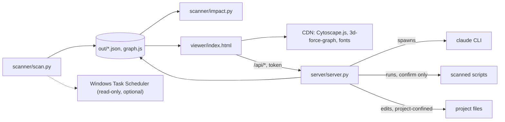

# Architecture

Update this file when a module boundary or an external call changes.

## Overview
Agentic View scans a folder of projects (each immediate subfolder is one project) and builds a dependency map: which files import or run which, which projects read each other's files, and which external systems each file touches. It runs on demand from the command line. No database; data lives in JSON files under `out/`. A static HTML page reads them, and an optional local server (`server/server.py`) adds management features: streamed Claude chat per project, running scripts, editing files and Claude setup.

## Entry points
- `scanner/scan.py` - run manually via `python scanner/scan.py`; writes everything under `out/`.
- `scanner/impact.py` - run manually via `python scanner/impact.py <file>`; reads `out/` and prints what depends on a file.
- `viewer/index.html` - open directly (map only) or through the server (map plus management tabs); reads `out/graph.js`.
- `server/server.py` - run manually via `python server/server.py`; binds 127.0.0.1, serves the viewer and the `/api/*` endpoints.
- `start_windows.bat`, `start_mac.command`, `start_ubuntu.sh` - one launcher per OS: check Python 3.9+, then run `launcher.py`. Extra flags pass through to the server.
- `launcher.py` - asks which access level to start with (1 read only, 2 allow edit, 3 allow bypass with a typed YES) unless a mode flag was passed or there is no terminal; then runs `scanner/scan.py` and `server/server.py` (with `AV_LAUNCHER=1`), and repeats both, keeping the same flags, when the server exits with code 75 (restart requested after an update).
- `create_shortcut.py` - run manually via `python create_shortcut.py`; writes a Desktop shortcut that runs the OS launcher (`start_windows.bat`, `start_mac.command`, `start_ubuntu.sh`). Standard library only; Windows uses PowerShell/WScript.Shell, Linux uses `xdg-user-dir` and `gio`.
- `INSTALL.md` - install steps for humans and AI assistants; keep in line with the flags and config keys used by `scanner/scan.py`, `server/server.py` and the launchers.
- `VERSION` - current release number (semantic versioning); read by `server/server.py`, shown in the page header. Release history is in `CHANGELOG.md`; releases are git tags `vX.Y.Z`.

## Modules
Module-level detail: the project is four small files, each documented by its public behaviour.

### scanner/scan.py
- Purpose: discover files, parse them, resolve links (file imports, Python function calls, shell runs, cross-project paths), write outputs. First run in a terminal with no config asks for the projects folder and writes `scanner/config.local.json` (`first_run_setup`). Skips its own folder, and exits 1 with a message when the root has no projects.
- Cross-module calls: writes `out/graph.json`, `out/graph.js`, `out/impact.json`, `out/INDEX.md`, `out/cache.json`.
- Depends on (this codebase): none (Python standard library only).
- Called by / Depended on by (this codebase): `scanner/impact.py` and `viewer/index.html` read its output files.
- External: optionally runs `schtasks /query` (read-only, Windows) when `schedule` is enabled.

### server/server.py
- Purpose: local HTTP server (standard library). Keeps a live `claude` session per project (stream-json over stdin/stdout, replayable), creates new projects (folder, CLAUDE.md goal/tasks/related, Handover, architecture stub), runs and stops scanned scripts, interrupts a chat turn without ending the session (`/api/run/<id>/interrupt`, sends a stream-json `control_request`), reads and writes project files, copies dropped files into a project (`/api/upload`), opens a file or folder in the OS file manager or default app (`/api/open`), lists and controls Windows Task Scheduler jobs (`/api/jobs`, `/api/job`), checks for and installs a newer release from GitHub without git (`/api/update/check`, `/api/update`), reruns the scanner, runs the Claude install and sign-in.
- Cross-module calls: imports `scanner/scan.py` for config defaults and the secret-file globs; reads `out/graph.json` to map project and file ids to folders; starts `scanner/scan.py` as a subprocess; writes file edits and backups (`out/backups/`).
- Flags: `--read-only`, `--allow-bypass`, `--allow-edit` (adds `--allowedTools "Bash(python *)" "PowerShell(python *)"` to non-plan, non-bypass chat sessions).
- Depends on (this codebase): `scanner/scan.py`, `out/graph.json`.
- Called by / Depended on by (this codebase): `viewer/index.html` calls its `/api/*` endpoints.
- External: spawns one long-lived `claude` process per live session and `claude auth login` for sign-in; runs the official Claude installer command (fixed per OS, only after the page echoes it back); runs scanned scripts with the local interpreter; runs `schtasks` (query, run, change enable/disable) and the OS opener (`explorer`, `os.startfile`, `open`, `xdg-open`).

### scanner/impact.py
- Purpose: answer "what breaks if I change this file" and "what touches this target".
- Cross-module calls: reads `out/graph.json` and `out/impact.json`.
- Depends on (this codebase): `scanner/scan.py` output.
- Called by / Depended on by (this codebase): none.

### viewer/index.html
- Purpose: board view (a column per project: uses, external, used by) plus an interactive map (2D Cytoscape, 3D force graph) with project, file and function drill-down, impact highlighting, plus (when served) Chat (with mode, context and model pickers, Stop and Latest-message buttons), Files (folder tree, refetched on every open and after each chat turn, drag-and-drop upload, open buttons), Scripts, Scheduler Job tabs, a full-width project layout, a "Scheduler jobs only" filter, a global jobs dialog and the Setup dialog.
- Cross-module calls: loads `out/graph.js` (sets `AGENTIC_GRAPH` and `AGENTIC_IMPACT`).
- Depends on (this codebase): `scanner/scan.py` output; `server/server.py` endpoints when served.
- Called by / Depended on by (this codebase): none.
- External: loads Cytoscape.js, 3d-force-graph and web fonts from public CDNs.

## Dependency graph (condensed)

## External system boundaries
- Windows Task Scheduler: `scan.py` reads task names and commands with `schtasks /query` to mark scheduled scripts (read-only, on by default, skipped on non-Windows). `server.py` also queries it live and, after a confirm in the page, runs `schtasks /run` or `/change /enable|/disable` for tasks that run a scanned file only. Blocked in `--read-only`.
- GitHub (self-update): `server.py` calls `api.github.com/repos/<repo>/tags` to find the newest `vX.Y.Z` tag, and on confirm downloads `github.com/<repo>/archive/refs/tags/<tag>.zip` (public repo, no credentials, 20 MB cap). It checks the archive layout and that every `.py` compiles, backs up the files it replaces to `out/backups/update-*`, then writes only `scanner/`, `server/`, `viewer/`, launchers and root docs. Local config, `out/` and project folders are never written. Refused in a git clone and in `--read-only`. After the swap the server restarts itself: it exits 75 under `launcher.py`, otherwise it starts a fresh copy of itself (new console window on Windows) and exits; the page polls `/` and reloads when the new version answers. The repo name is a constant in `server.py`.
- OS file manager and default apps: `server.py` asks the OS to show a project file or folder (`explorer /select,`, `open -R`, `xdg-open`) or open it with its default app. Types that would execute when opened (scripts, executables) are refused for the default app.
- Dropped files: the page reads files dragged from Explorer/Finder and posts them to `/api/upload`; the server writes them inside the target project folder only, refuses secret names and traversal, never replaces without an explicit overwrite (old copy goes to `out/backups/`).
- CDN (cdnjs, unpkg, Google Fonts): the viewer fetches Cytoscape.js, 3d-force-graph and fonts at page load.
- Claude CLI: the server spawns a long-lived `claude -p --input-format stream-json --output-format stream-json` process in a project folder per live session (max 6), and `claude auth login` for sign-in. Prompts go to Anthropic through the CLI.
- Scan root: the server creates new project folders (scaffold files only) directly under the configured scan root; names are validated and existing folders are never overwritten.
- Claude installer: the server can run the official install command (`irm https://claude.ai/install.ps1 | iex` on Windows, `curl -fsSL https://claude.ai/install.sh | bash` elsewhere) after the user confirms it in the page.
- Local processes: scanned scripts run with the local interpreter (`python`, `node`, PowerShell, cmd) in their own folder, no arguments, after a confirm dialog.
- Project files: the server reads and writes text files inside a scanned project folder; secret files (.env, keys, tokens) and `.git` are refused; previous versions go to `out/backups/`.
- Scanned projects: read-only. `.env` files are never opened; only env key names found in code and URL hostnames are stored.

## Known gaps / TODO
- Function level covers Python only (top-level functions and classes; class methods are not separate nodes). JS/TS stay file-level.
- Static analysis cannot see dynamic imports, runtime-built URLs or data passed through sheets; edges carry a confidence tag (exact, resolved, heuristic, doc).
- Chat is a live stream-json session, not a PTY terminal (no slash commands or TUI). The CLI cannot ask the page to approve a tool: denied tools are reported in the chat. Modes are project settings, accept-edits, plan, or bypass (needs `--allow-bypass`). A real terminal (PTY plus xterm.js) is not built.
- Scheduler jobs cover Windows Task Scheduler only (English column names expected); cron and launchd are not read. Enable, Disable and Run now were not exercised against a real task during development (only the guards and the query were).
- macOS and Linux launchers and the `open`/`xdg-open` paths are written but were not run on those systems.
- The updater was tested end to end on Windows only (downloaded the real v1.1.0 tag into a copy of the app). Unchanged files are skipped; a file that cannot be replaced is written as `.av-new` and listed for a manual rename. It does not delete files that a newer release removed, except the old `start.bat` and `start.sh`.
- Dropped folders are skipped (files only). Moving files inside the tree is not built.
- The server has no multi-user auth. It is for the local machine only.

## Last checked
- 2026-10-27 (v1.5.0): module boundaries and external calls checked against scanner/scan.py, scanner/impact.py, server/server.py, viewer/index.html, launcher.py, the three launchers.
