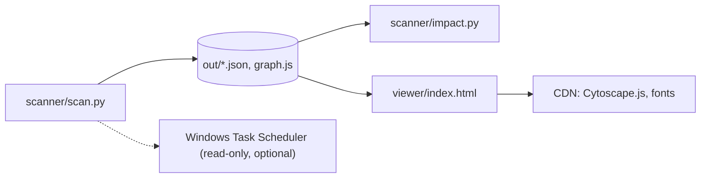

# Architecture

Update this file when a module boundary or an external call changes.

## Overview
Agentic View scans a folder of projects (each immediate subfolder is one project) and builds a dependency map: which files import or run which, which projects read each other's files, and which external systems each file touches. It runs on demand from the command line. No database and no server; data lives in JSON files under `out/`, and a static HTML page reads them.

## Entry points
- `scanner/scan.py` - run manually via `python scanner/scan.py`; writes everything under `out/`.
- `scanner/impact.py` - run manually via `python scanner/impact.py <file>`; reads `out/` and prints what depends on a file.
- `viewer/index.html` - open in a browser; reads `out/graph.js`.

## Modules
Module-level detail: the project is three small scripts, each documented by its public behaviour.

### scanner/scan.py
- Purpose: discover files, parse them, resolve links, write outputs.
- Cross-module calls: writes `out/graph.json`, `out/graph.js`, `out/impact.json`, `out/INDEX.md`, `out/cache.json`.
- Depends on (this codebase): none (Python standard library only).
- Called by / Depended on by (this codebase): `scanner/impact.py` and `viewer/index.html` read its output files.
- External: optionally runs `schtasks /query` (read-only, Windows) when `schedule` is enabled.

### scanner/impact.py
- Purpose: answer "what breaks if I change this file" and "what touches this target".
- Cross-module calls: reads `out/graph.json` and `out/impact.json`.
- Depends on (this codebase): `scanner/scan.py` output.
- Called by / Depended on by (this codebase): none.

### viewer/index.html
- Purpose: interactive map with project to file drill-down, impact highlighting and a copy-command button.
- Cross-module calls: loads `out/graph.js` (sets `AGENTIC_GRAPH` and `AGENTIC_IMPACT`).
- Depends on (this codebase): `scanner/scan.py` output.
- Called by / Depended on by (this codebase): none.
- External: loads Cytoscape.js and web fonts from public CDNs.

## Dependency graph (condensed)

## External system boundaries
- Windows Task Scheduler: `scan.py` reads task names and commands with `schtasks /query` to mark scheduled scripts. Read-only, off by default.
- CDN (cdnjs, Google Fonts): the viewer fetches Cytoscape.js and fonts at page load.
- Scanned projects: read-only. `.env` files are never opened; only env key names found in code and URL hostnames are stored.

## Known gaps / TODO
- File-level only. Function-level nodes and call edges are planned (phase 2).
- Static analysis cannot see dynamic imports, runtime-built URLs or data passed through sheets; edges carry a confidence tag (exact, resolved, heuristic, doc).
- No 3D view and no one-click Claude launcher yet (planned).

## Last checked
- 2026-10-27: module boundaries checked against scanner/scan.py, scanner/impact.py, viewer/index.html.
