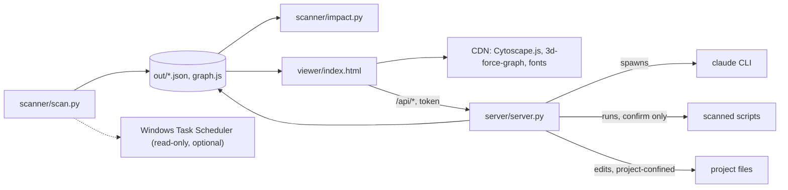

# Architecture

Update this file when a module boundary or an external call changes.

## Overview
Agentic View scans a folder of projects (each immediate subfolder is one project) and builds a dependency map: which files import or run which, which projects read each other's files, and which external systems each file touches. It runs on demand from the command line. No database; data lives in JSON files under `out/`. A static HTML page reads them, and an optional local server (`server/server.py`) adds management features: streamed Claude chat per project, running scripts, editing files and Claude setup.

## Entry points
- `scanner/scan.py` - run manually via `python scanner/scan.py`; writes everything under `out/`.
- `scanner/impact.py` - run manually via `python scanner/impact.py <file>`; reads `out/` and prints what depends on a file.
- `viewer/index.html` - open directly (map only) or through the server (map plus management tabs); reads `out/graph.js`.
- `server/server.py` - run manually via `python server/server.py`; binds 127.0.0.1, serves the viewer and the `/api/*` endpoints.

## Modules
Module-level detail: the project is four small files, each documented by its public behaviour.

### scanner/scan.py
- Purpose: discover files, parse them, resolve links (file imports, Python function calls, shell runs, cross-project paths), write outputs. First run in a terminal with no config asks for the projects folder and writes `scanner/config.local.json` (`first_run_setup`). Skips its own folder, and exits 1 with a message when the root has no projects.
- Cross-module calls: writes `out/graph.json`, `out/graph.js`, `out/impact.json`, `out/INDEX.md`, `out/cache.json`.
- Depends on (this codebase): none (Python standard library only).
- Called by / Depended on by (this codebase): `scanner/impact.py` and `viewer/index.html` read its output files.
- External: optionally runs `schtasks /query` (read-only, Windows) when `schedule` is enabled.

### server/server.py
- Purpose: local HTTP server (standard library). Keeps a live `claude` session per project (stream-json over stdin/stdout, replayable), creates new projects (folder, CLAUDE.md goal/tasks/related, Handover, architecture stub), runs and stops scanned scripts, reads and writes project files, reruns the scanner, runs the Claude install and sign-in.
- Cross-module calls: imports `scanner/scan.py` for config defaults and the secret-file globs; reads `out/graph.json` to map project and file ids to folders; starts `scanner/scan.py` as a subprocess; writes file edits and backups (`out/backups/`).
- Flags: `--read-only`, `--allow-bypass`, `--allow-edit` (adds `--allowedTools "Bash(python *)" "PowerShell(python *)"` to non-plan, non-bypass chat sessions).
- Depends on (this codebase): `scanner/scan.py`, `out/graph.json`.
- Called by / Depended on by (this codebase): `viewer/index.html` calls its `/api/*` endpoints.
- External: spawns one long-lived `claude` process per live session and `claude auth login` for sign-in; runs the official Claude installer command (fixed per OS, only after the page echoes it back); runs scanned scripts with the local interpreter.

### scanner/impact.py
- Purpose: answer "what breaks if I change this file" and "what touches this target".
- Cross-module calls: reads `out/graph.json` and `out/impact.json`.
- Depends on (this codebase): `scanner/scan.py` output.
- Called by / Depended on by (this codebase): none.

### viewer/index.html
- Purpose: board view (a column per project: uses, external, used by) plus an interactive map (2D Cytoscape, 3D force graph) with project, file and function drill-down, impact highlighting, plus (when served) Chat, Files, Scripts tabs and the Setup dialog.
- Cross-module calls: loads `out/graph.js` (sets `AGENTIC_GRAPH` and `AGENTIC_IMPACT`).
- Depends on (this codebase): `scanner/scan.py` output; `server/server.py` endpoints when served.
- Called by / Depended on by (this codebase): none.
- External: loads Cytoscape.js, 3d-force-graph and web fonts from public CDNs.

## Dependency graph (condensed)

## External system boundaries
- Windows Task Scheduler: `scan.py` reads task names and commands with `schtasks /query` to mark scheduled scripts. Read-only, off by default.
- CDN (cdnjs, unpkg, Google Fonts): the viewer fetches Cytoscape.js, 3d-force-graph and fonts at page load.
- Claude CLI: the server spawns a long-lived `claude -p --input-format stream-json --output-format stream-json` process in a project folder per live session (max 6), and `claude auth login` for sign-in. Prompts go to Anthropic through the CLI.
- Scan root: the server creates new project folders (scaffold files only) directly under the configured scan root; names are validated and existing folders are never overwritten.
- Claude installer: the server can run the official install command (`irm https://claude.ai/install.ps1 | iex` on Windows, `curl -fsSL https://claude.ai/install.sh | bash` elsewhere) after the user confirms it in the page.
- Local processes: scanned scripts run with the local interpreter (`python`, `node`, PowerShell, cmd) in their own folder, no arguments, after a confirm dialog.
- Project files: the server reads and writes text files inside a scanned project folder; secret files (.env, keys, tokens) and `.git` are refused; previous versions go to `out/backups/`.
- Scanned projects: read-only. `.env` files are never opened; only env key names found in code and URL hostnames are stored.

## Known gaps / TODO
- Function level covers Python only (top-level functions and classes; class methods are not separate nodes). JS/TS stay file-level.
- Static analysis cannot see dynamic imports, runtime-built URLs or data passed through sheets; edges carry a confidence tag (exact, resolved, heuristic, doc).
- Chat is a live stream-json session, not a PTY terminal (no slash commands or TUI). The CLI cannot ask the page to approve a tool: denied tools are reported in the chat. Modes are project settings, accept-edits, plan, or bypass (needs `--allow-bypass`). A real terminal (PTY plus xterm.js) is not built.
- The server has no multi-user auth. It is for the local machine only.

## Last checked
- 2026-10-27: module boundaries and external calls checked against scanner/scan.py, scanner/impact.py, server/server.py, viewer/index.html.
